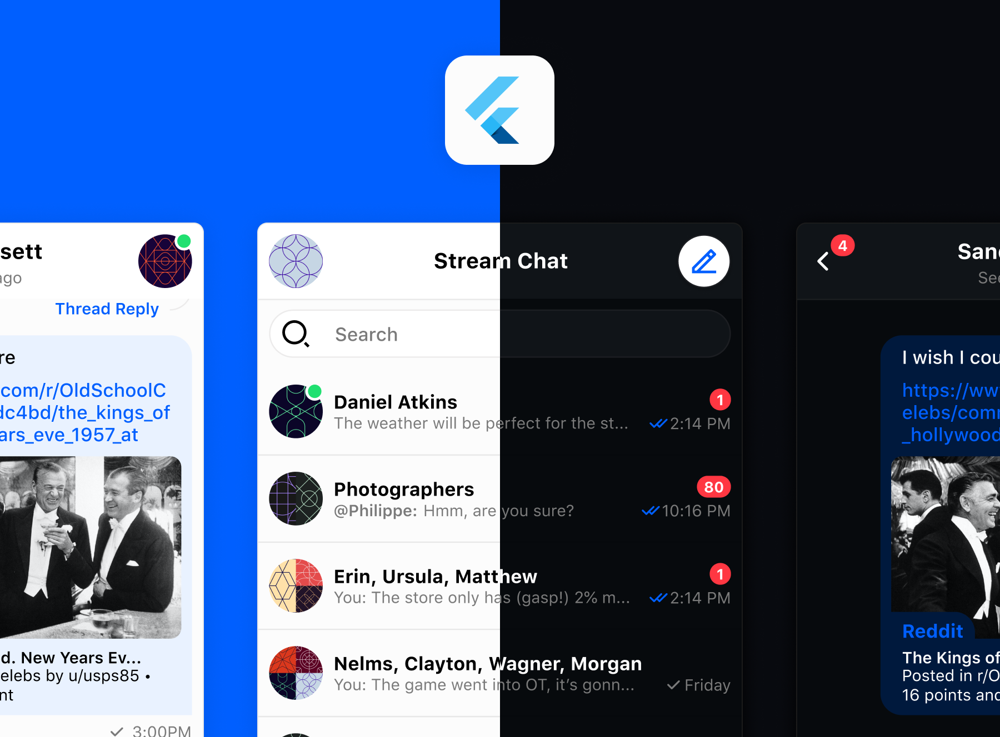

# Stream Flutter Samples

> [!WARNING]
> **This repository is archived and no longer maintained.**
>
> The samples here were built against older versions of Flutter and the Stream SDKs and will not receive updates or fixes.
>
> **For an up-to-date sample app, go to [`sample_app` in the `stream-chat-flutter` repository](https://github.com/GetStream/stream-chat-flutter/tree/master/sample_app).** It is maintained alongside the Flutter Chat SDK and always targets the latest release.

## 😎 Repo Overview

This repo contains official Stream projects, guides, links to helpful resources, and excellent tutorials and samples developed by the Flutter community. 

#### Quick Links

- [Register For a Free Account](https://getstream.io/try-for-free/)
- [Stream Flutter YouTube Playlist](https://www.youtube.com/playlist?list=PLNBhvhkAJG6t-BxkRAnSqa67lm5C1mpKk)

**Chat:**
- [Flutter Chat Tutorial](https://getstream.io/chat/flutter/tutorial/)
- [Flutter Chat SDK Repo](https://github.com/GetStream/stream-chat-flutter)
- [Flutter Chat Client Documentation](https://getstream.io/chat/docs/flutter-dart/?language=dart)
- [Flutter Chat UI Documentation and Helpful Guides](https://getstream.io/chat/docs/sdk/flutter/)
- [Chat UI Kit](https://getstream.io/chat/ui-kit/)

**Feeds:**
- [Flutter Feed Tutorial](https://getstream.io/activity-feeds/sdk/flutter/tutorial/)
- [Flutter Feed SDK Repo](https://github.com/GetStream/stream-feed-flutter)
- [Flutter Feed Client Documentation](https://getstream.io/activity-feeds/docs/flutter-dart/?language=dart)

🔎  Official Samples and Tutorials
------------

| 🔮 Official Samples | |
|:-----|---------|
|   <h3>Stream Chat Sample Application</h3>A fully fledged messaging application, demoing everything you can do with Stream Chat Flutter, using our <a href="https://pub.dev/packages/stream_chat_flutter">UI package</a>.  • Maintained to support the latest version of the SDK • Combination of pre-made widgets and custom widgets • Light & dark themes • Localization • Multiple users accounts • Message search and filtering  • Create private and group chats  • View @mentions  • View pinned messages, files, photos and videos  • Base Stream Chat functionality    **[> Source Code](packages/stream_chat_v1)**   |  |
| ⚙️ Tutorials | |
|   <h3>Stream Chat Flutter Core Application</h3>**[> YouTube Tutorial Playlist](https://www.youtube.com/playlist?list=PLNBhvhkAJG6sH7dkmwt4BiCclFkMoXq4r)**  An ongoing, beginner friendly, series, demoing how to use the <a href ="https://pub.dev/packages/stream_chat_flutter_core">Stream Chat Flutter Core package</a> for lower level control and customization options.  •  Custom UI components  • Lower level client integration • Light & dark themes • Multiple users accounts  • Firebase Authentication  • Firebase Cloud Functions to generate user tokens • Create private chats    **[> Source Code](https://github.com/HayesGordon/chatter)**   |  |
|   <h3>Instagram Clone</h3>**[> YouTube Tutorial](https://youtu.be/fHRB6KGoaV0)** **[> Written Tutorial](https://getstream.io/blog/instagram-clone-flutter/)**  A tutorial showing how to use <a href="https://github.com/GetStream/stream-feed-flutter">Stream Feed Flutter</a> to create an Instagram clone using activity feeds.  •  Instagram-like animations and transitions  • Light & dark themes • Add and change profile pictures • Multiple users accounts  • State management with Provider • Application architecture  • Add photo posts to your own user feed (activities) • Follow/Unfollow other users' feeds  • Add comments and likes (reactions)   **[> Source Code](https://github.com/GetStream/flutter-instagram-clone)**   |  |
|   <h3>iMessage Clone</h3>**[> Written Tutorial](https://getstream.io/blog/build-an-imessage-clone-with-streams-flutter-chat-sdk/)**  This tutorial shows how to use <a href="https://pub.dev/packages/stream_chat_flutter_core">Stream Chat Flutter Core</a> to create a basic chat application, styled similar to iMessage.  • Custom chat bubbles with a custom painter  • Core chat components • Sending attachments  • Chat functionality • List all channels  **[> Source Code](https://github.com/GetStream/flutter-samples/tree/main/packages/imessage)**   |  |
|   <h3>Chess Game in Chat</h3>**[> Written Tutorial](https://getstream.io/blog/messenger-chess-chat-app/)**  A fun tutorial showing you how customizable <a href="https://pub.dev/packages/stream_chat_flutter">Stream Chat Flutter</a> is by adding a chess game to your chat app.  • Custom Stream Chat Attachments  • Two player, or group match • Sending attachments  • Base chat functionality • Updating messages/attachments  **[> Source Code](https://github.com/deven98/stream_chess_demo)**   |  |
| ⚙️ Codelabs | |
|   <h3>Animated Stickers And Reactions With Rive</h3>**[> Codelab](https://getstream.io/codelabs/flutter/flutter-chat-and-rive-animations/)**  Add animated reactions and stickers to your chat application using <a href ="https://rive.app/">Rive</a>.  •  Rive animations  • Custom attachments • Custom reactions    **[> Source Code](https://github.com/HayesGordon/stream-chat-flutter-animated-stickers)**   |  |
|  |  |

## Chat Guides
See [here](https://getstream.io/chat/docs/sdk/flutter/) for all our chat guides.

These guides explore our UI components in greater detail and demonstrate how to easily perform a variety of common actions using the Stream Chat Flutter SDK, such as:
- [Adding Push Notifications](https://getstream.io/chat/docs/sdk/flutter/guides/adding_push_notifications_v2/)
- [Adding Localization](https://getstream.io/chat/docs/sdk/flutter/guides/adding_localization/)
- [Adding Custom Attachments - Location Sharing](https://getstream.io/chat/docs/sdk/flutter/guides/adding_custom_attachments/)
- [Token Generation With Firebase Auth and Cloud Functions](https://getstream.io/chat/docs/sdk/flutter/guides/token_generation_with_firebase/)
- [Adding Chat To Video Livestreams](https://getstream.io/chat/docs/sdk/flutter/guides/adding_chat_to_video_livestreams/)
- [Adding Local Data Persistence](https://getstream.io/chat/docs/sdk/flutter/guides/adding_local_data_persistence/)
- [Understanding Filters](https://getstream.io/chat/docs/sdk/flutter/guides/understanding_filters/)
- [End To End Chat Encryption](https://getstream.io/chat/docs/sdk/flutter/guides/end_to_end_chat_encryption/)

## Chat Tutorials
Chat tutorials that go into greater detail on certain topics:
- [Add Peer-to-Peer Payment Integration With Stream and Rapyd](https://getstream.io/blog/p2p-integration-with-flutter/)
- [Send Voice Messages](https://getstream.io/blog/instantly-send-audio-messages-with-stream-chat-and-flutter/)
- [Location Sharing](https://getstream.io/blog/add-location-sharing-to-a-messaging-app-using-flutter/)
- [Conversational AI with HuggingFace and DialogGPT](https://getstream.io/blog/conversational-ai-flutter/)

## What is Stream?

Stream allows developers to rapidly deploy scalable feeds and chat messaging with an industry-leading 99.999% uptime SLA guarantee.

With Stream's chat components, developers quickly add chat to their app for a variety of use-cases:

- Livestreams like Twitch or Youtube
- In-Game chat like Overwatch or Fortnite
- Team style chat like Slack
- Messaging style chat like Whatsapp or Facebook's messenger
- Commerce chat like Drift or Intercom

## 📕 Historic Projects
*These projects are not actively maintained. They were developed using older versions of our packages and Flutter.*
- [Stream Chatty](https://github.com/GetStream/flutter-samples/tree/main/packages/chatty) Stream Chatty is a sample chat app made in Flutter using Stream Chat, Firebase, and flutter_bloc. It has full light and dark mode support, real-time chat, and full authentication using Firebase auth.

## 🛠 Requirements

Before running this project, please ensure Flutter is installed and configured on your machine. If you're new to Flutter, please check out the [official guide](https://flutter.dev/docs/get-started/install) with installation instructions for your OS. 

## 📈 Contributing

- How can I submit a sample app?
    - Apps submissions are always welcomed! 🥳 Open a pr with a proper description, and we'll review it as soon as possible
- Spot a bug 🕷?
    - We welcome code changes that improve the apps or fix a problem. Please follow all best practices and add tests if applicable before submitting a Pull Request on Github.
